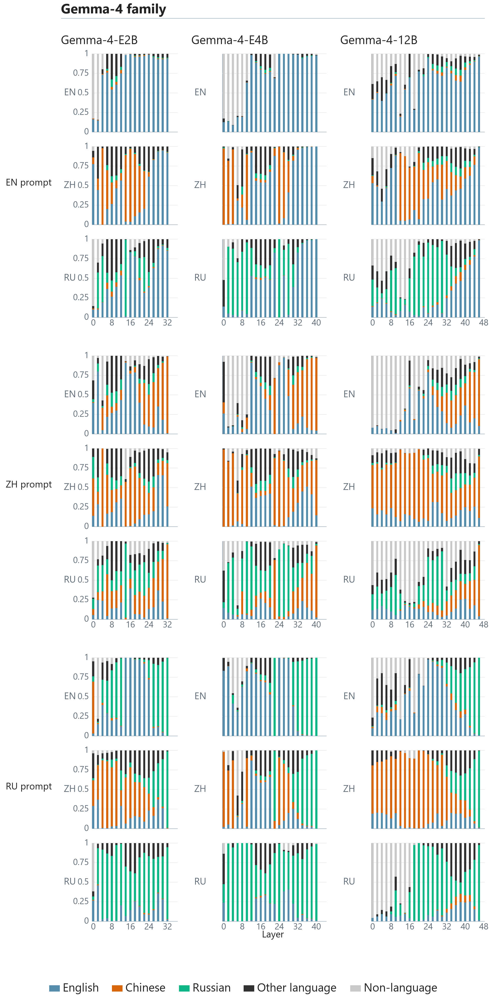
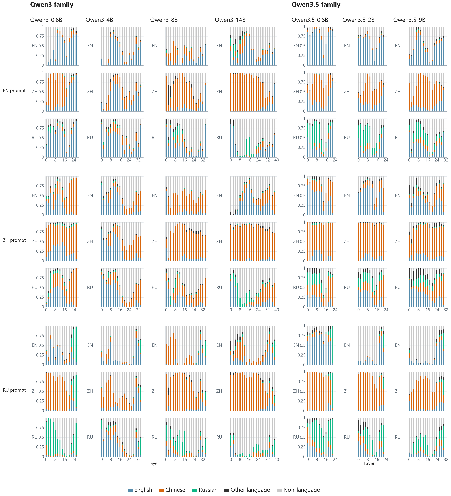
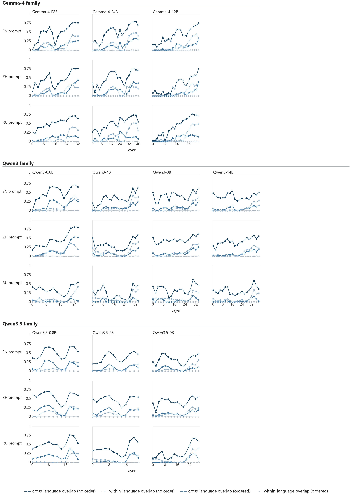
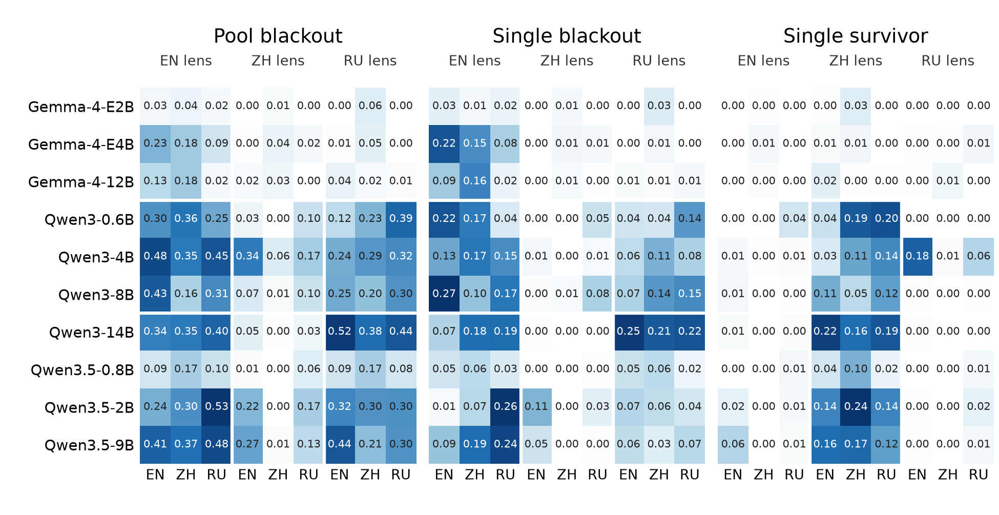

# 3. Results

## 3.1 Language shares

All tests are Type III tests with Satterthwaite denominator degrees of freedom. For English share (Figures 1 and 2), the main effect of lens language was significant in all ten models (F(2, 2376) = 2,245–31,047, all p < .001). Post-hoc comparisons on the lens main effect placed the English band above the Chinese band by 0.03–0.54 (|t(2376)| = 12.1–238.0, all p < .001), whereas the English-fitted lens did not stand consistently above the Russian-fitted lens (difference −0.14 to 0.42). The main effect of prompt language was also significant in all ten models (F(2, 2376) = 641–23,348, all p < .001): the English band was largest at the English prompt, at 50.1% against 28.7% at the Russian prompt and 23.0% at the Chinese prompt under the English-fitted lens, and simple-effect tests of prompt language within every lens level were significant in all ten models (F = 24–12,386, all p < .001). The prompt × lens interaction was significant in all ten models (F(4, 2376) = 22–1,414, all p < .001), so the size of the prompt effect differed across lenses.

For Chinese share, the same structure appeared with the bands reversed. Lens language was significant in all ten models (F(2, 2376) = 9,704–79,409, all p < .001), and post-hoc comparisons placed the Chinese-fitted lens above the English-fitted lens by 0.19–0.72 (|t(2376)| = 80.7–356.5) and above the Russian-fitted lens by 0.16–0.71 (|t(2376)| = 73.1–332.5), all p < .001. Prompt language was significant in all ten models (F(2, 2376) = 4,687–29,857, all p < .001), and the Chinese band was largest at the Chinese prompt, at 68.5% against 48.8% at the Russian prompt and 46.3% at the English prompt under the Chinese-fitted lens. The prompt × lens interaction was significant in all ten models (F(4, 2376) = 19–1,339, all p < .001).

For Russian share, lens language was significant in all ten models (F(2, 2376) = 3,958–79,698, all p < .001), and the Russian-fitted lens exceeded the English-fitted lens by 0.08–0.60 (|t(2376)| = 37.8–347.1) and the Chinese-fitted lens by 0.12–0.59 (|t(2376)| = 56.4–344.4), all p < .001. Prompt language was significant in all ten models (F(2, 2376) = 1,652–39,916, all p < .001), and the Russian band was largest at the Russian prompt, at 37.0% against 24.9% at the English prompt and 18.1% at the Chinese prompt under the Russian-fitted lens. The prompt × lens interaction was significant in all ten models (F(4, 2376) = 55–2,626, all p < .001).

Figure 1. Language composition of the Gemma-4 family. Rows are the prompt language (English, Chinese, Russian); columns are the three checkpoints ordered by size, smallest to largest; inside each cell the three lens rows are the English-fitted, Chinese-fitted and Russian-fitted readouts. Each bar is one measured layer, and the five bands (English, Chinese, Russian, other language, non-language) sum to one. Data are the P1 country-capital probes (100 items), top-100 candidates at the last prompt position; the item-level models of Section 2.6 pool all 300 probes across the three probe families.

Figure 2. Language composition of the Qwen3 and Qwen3.5 families, in the layout of Figure 1. Qwen3 contributes four checkpoints and Qwen3.5 three, so the two families are shown side by side under their own headings. Each bar is one measured layer, and the five bands (English, Chinese, Russian, other language, non-language) sum to one. Data are the P1 country-capital probes (100 items), top-100 candidates at the last prompt position.

The remaining mass split between the other-language and the non-language band. Both bands varied with lens language and with prompt language in all ten models (all p < .001), and the other-language band stayed below 7% in every cell (2.3–6.8%). Probe family entered every model significantly (F(2, 297) = 193–1,062 for the English band, 34–998 for the Chinese band and 27–1,190 for the Russian band, all p < .001), and the three-way interaction was significant in all ten models for every band (F(8, 2376) = 32–1,293, all p < .001). English share was highest for the country-capital family (P1, 27.0%), intermediate for the category-clue family (P4, 25.0%) and lowest for the definitional family (P3, 19.4%), and the other-language band followed the same order (6.0%, 3.9% and 3.8%).

The composition results describe the structure of the candidate pool rather than the identity of the answer. Hit@100, the share of measured cells in which the answer family appeared among the top-100 decoded candidates, spanned 0.039–0.322 across the 90 model × lens × prompt-language combinations (mean 0.125; P4 0.145, P1 0.135, P3 0.095).

## 3.2 Semantic overlap

For three-way overlap (Figure 3), cross-language overlap without order was far above identical-string overlap without order at every depth: across the ten models, 39.5–44.3% of positions carried a translated counterpart in each of the other two lists (m1), against 10.7–12.3% carrying the same string (m3), a ratio of about 3.7.

Ordering agreements were rarer. Requiring the same rank reduced cross-language overlap to 7.7–12.3% (m2) and identical-string overlap to about 0.1% (m4), so the rank-preserving fraction was about a quarter for translation matches (m2/m1 = 0.24) and about 0.7% for string matches (m4/m3).

Prompt language moved the overlap in all ten models (m1: F(2, 594) = 8.9–1,763; m2: F(2, 594) = 47–3,231; m3: F(2, 594) = 85–642; all p ≤ .0013). Cross-language overlap without order was highest under English (44.0%) and Chinese (44.3%) prompts and lowest under Russian prompts (39.5%), and the ordered cross-language measure followed the same order (11.1%, 12.3% and 7.7%). Identical-string overlap was highest under Chinese prompts (12.3% against 10.7% and 11.2%), and the Chinese prompt differed from the English prompt in every model (|t(594)| = 7.2–27.1, all p < .001) and from the Russian prompt in nine of the ten (|t(594)| = 2.0–35.1).

Probe family moved the overlap as well (m1: F(2, 297) = 10.6–851; m3: F(2, 297) = 27.5–1,454; all p < .001), and the family × prompt interaction was significant in all ten models (F(4, 594) = 109–679 for m1 and 90–1,278 for m3, all p < .001). The country-capital family gave the highest cross-language and identical-string overlap (m1 49.0%, m3 14.9%), the category-clue family the lowest cross-language overlap (38.3%) and the definitional family the lowest identical-string overlap (8.7%).

The ordered identical-string measure sat at the floor in every cell (mean 0.1%). Its prompt effect was significant (F(2, 594–891) = 5.1–78.5, p ≤ .006), but its family effect was not significant in every model (F(2, 297) = 0.8–149.5, p up to .43), so m4 is reported as a descriptive bound rather than as a tested quantity.

Read together, the measures show that what the lenses share is the translated concept rather than the literal token: agreement between languages was about 3.7 times as frequent as agreement on the same string, and even when rank was required the cross-language measure exceeded the identical-string one by about two orders of magnitude.

Figure 3. Three-way overlap between the three lenses by layer. Columns are the family’s checkpoints, ordered by size; rows are the prompt language; curves are the four overlap measures across the measured layers: cross-language overlap without order, within-language overlap without order, cross-language overlap with order and within-language overlap with order. The cross-language unordered curve is the highest throughout, the within-language unordered and cross-language ordered curves lie below it, and the within-language ordered curve stays at the floor. Data are the 300 probes (100 per family), top-100 pools at the last prompt position; each point is one measured layer.

## 3.3 Blackout rates

For pool blackout (Figure 4), lens language was the strongest factor in every model (F(2, 2376) = 199–10,610, all p < .001). Pools went dark most often under the English-fitted lens (0.267, 0.245 and 0.267 under English, Chinese and Russian prompts), less often under the Russian-fitted lens (0.204, 0.189 and 0.214) and least often under the Chinese-fitted lens (0.102, 0.018 and 0.078). Prompt language was significant in all ten models (F(2, 2376) = 125–1,380, all p < .001), as were the prompt × lens interaction (F(4, 2376) = 51–429), the probe-family effect (F(2, 297) = 16–451) and every higher-order term (F(8, 2376) ≥ 42), all p < .001.

The same ordering held when the pool was not wholly dark (Figure 4). On layers where exactly one lens was dark and the other two read, the dark lens was the English-fitted one in 0.117–0.126 of layers, the Russian-fitted one in 0.062–0.073 and the Chinese-fitted one in 0.004–0.018. Lens language (F(2, 2376–2673) = 115–7,861), prompt language (F = 17–530) and their interaction (F(4, 2376–2673) = 26–688) were significant in all ten models (all p < .001), as was the three-way interaction (F(8, 2376–2673) = 41–290).

The mirror image appeared for survival (Figure 4). On layers where exactly one lens read and the other two were dark, the survivor was the Chinese-fitted lens in 0.077–0.107 of layers, the Russian-fitted lens in 0.002–0.019 and the English-fitted lens in 0.002–0.011. Lens language (F(2, 2376–2673) = 8.8–7,335), prompt language (F = 6.2–488) and the prompt × lens interaction (F(4, 2376–2673) = 34–657) were significant in all ten models (p ≤ .0021), and so was the three-way interaction (F(8, 2376–2673) = 27–626).

Across the three outcomes the failure was one-sided: the English-fitted lens went dark and rarely survived alone, while the Chinese-fitted lens kept reading and rarely failed alone. Because the prompt × lens interaction was significant in every model and the rates moved with the prompt language, the asymmetry belongs to the pairing between a lens and the prompt language rather than to a fixed lens.

Figure 4. Blackout rates for the ten models, the three lenses and the three prompt languages. Each panel is one outcome: pool blackout (a pool is dark when its top 10 candidates carry no letter-bearing token and at least half of its top-100 slots are non-language), single blackout (exactly one lens dark, the other two reading) and single survivor (exactly one lens reading, the other two dark). Rows are models, grouped by family; the nine columns are the three lenses crossed with the three prompt languages; cells give the model-averaged proportion of measured layers, and cell shading tracks the value within each panel. Data are the 300 probes and the 100-candidate pools at the last prompt position.
