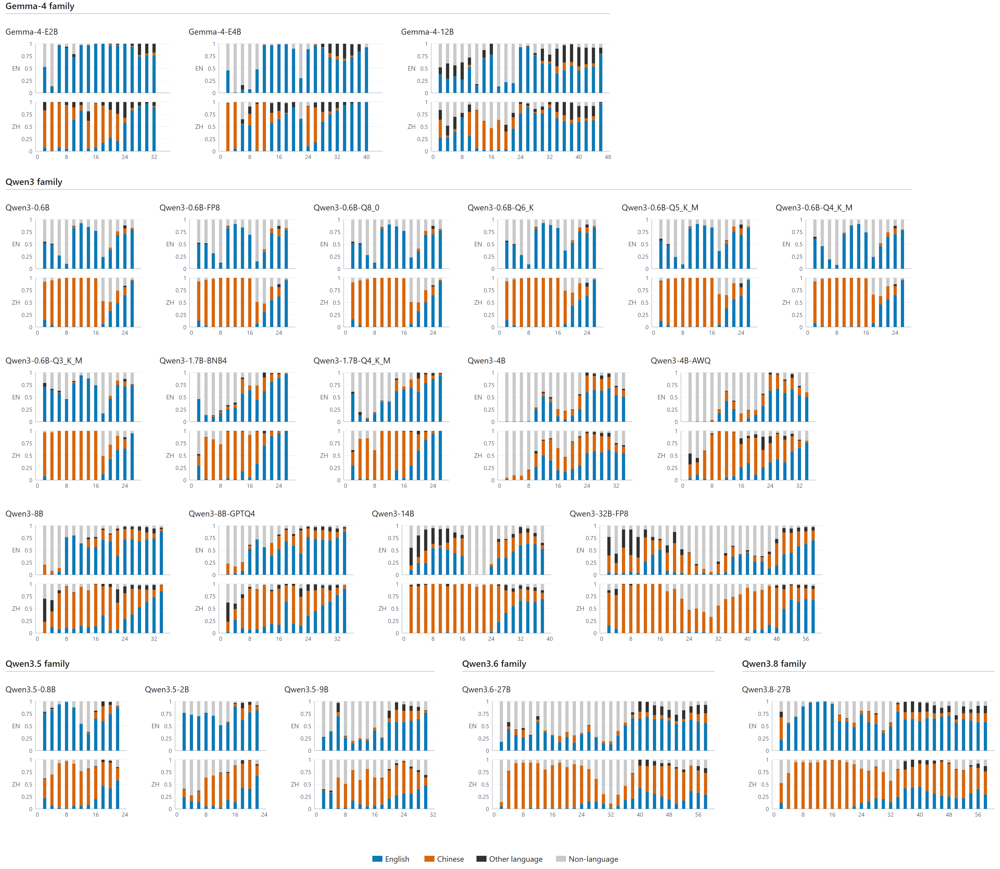
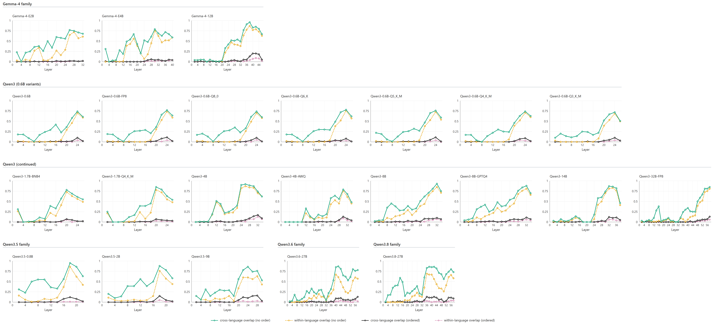
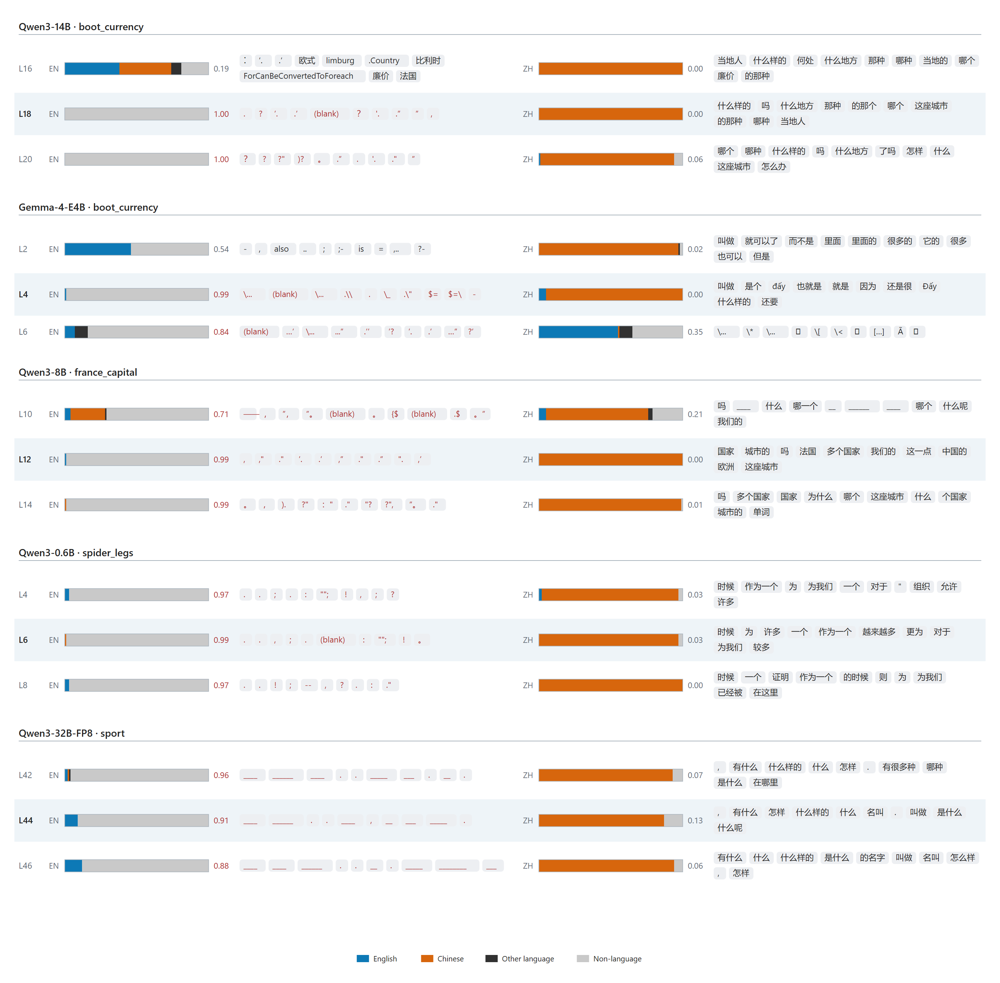
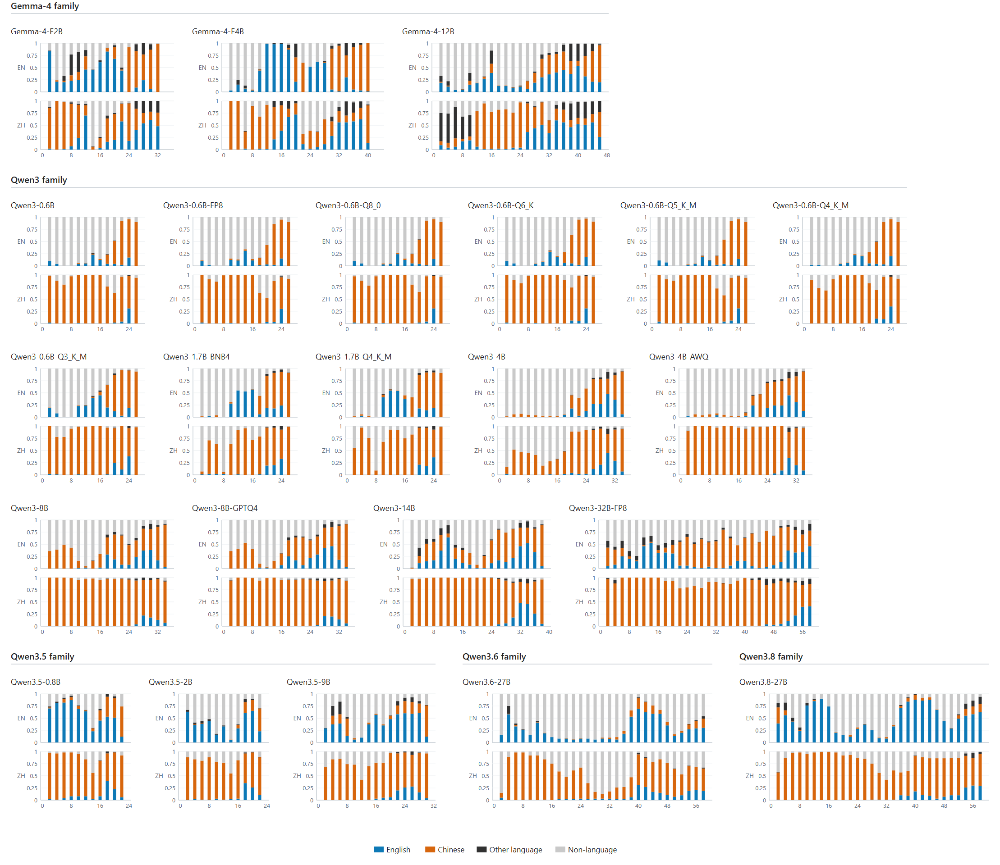
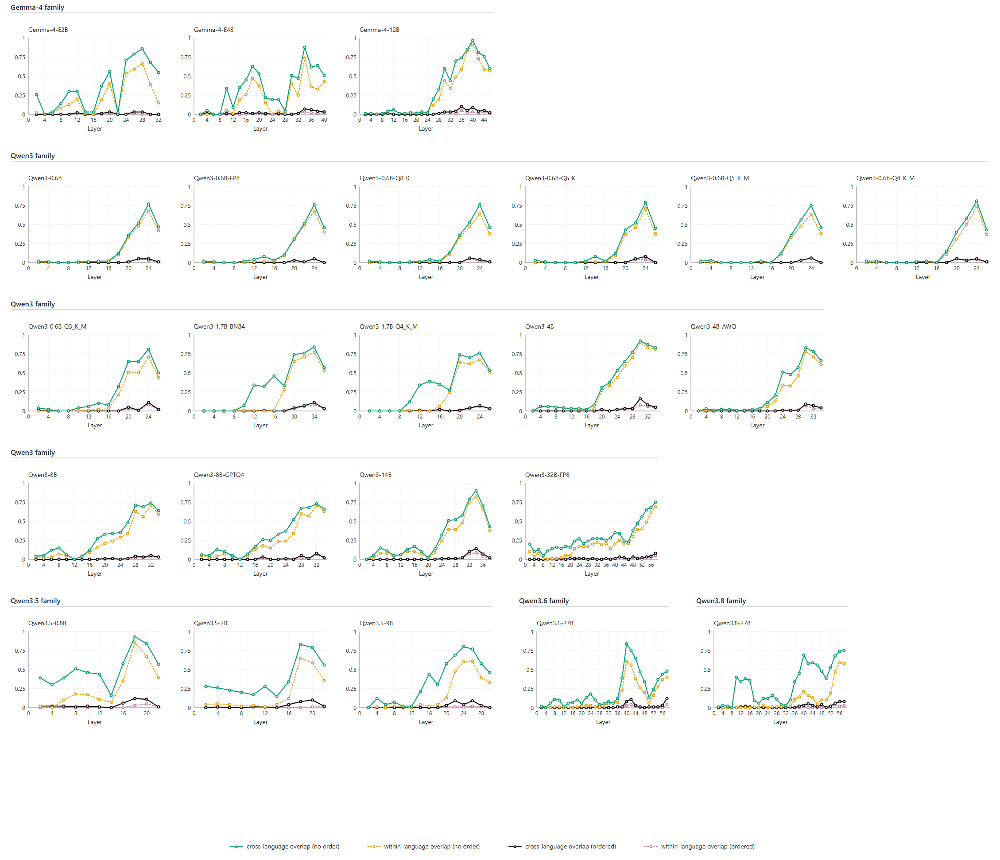
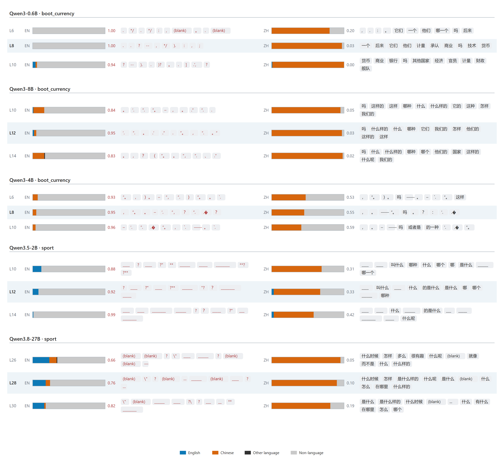

## J-Prism: Language Models Think Semantically, with Preferred Languages

J-Prism (repository `jprism-bilingual`) fits Jacobian lenses on English WikiText and on Chinese Wikipedia, measures what each lens reads, and compares the two readings. A J-lens is the Jacobian of the final-layer output with respect to an intermediate layer, averaged over a fitting corpus of 1,000 sequences of 128 tokens. Code is in `src/`; the fit cards are in `cards/`, the built corpora in `corpora/`, and the fitting protocol and corpus rules in [`docs/PROTOCOL.md`](docs/PROTOCOL.md) and [`docs/CORPORA.md`](docs/CORPORA.md).

With the exact same **prompt**, **model**, and **layer**, Qwen and Gemma models were probed with **Chinese** J-lenses and **English** J-lenses. The results could indicate:

| Interpretation | Evidence |
| --- | --- |
| The lens has a preference for languages | Each lens usually gives the larger share to the language it was fitted on. |
| The model has a preference for languages | The lens fitted on the model's own language usually reads a purer share of it than the other lens does. |
| The thinking has a preference for languages | A blackout usually falls on one lens while the other still reads. |
| The thinking is semantic | The two candidate lists overlap in meaning across the two fitted languages and a small minority of other languages. |

The probes are also asked in Chinese (`ZH_CLASSIC`, the hard translation of the four classic probes, recorded in `src/measure/pilot_core.py`). That second run keeps the models, the layers and both lenses fixed and changes only the language of the question; the three readings under it are in [Chinese probes](#chinese-probes), together with a re-test of the four interpretations.




**Figure 1.** Language composition of the candidate pools of both lenses. Currency probe at the last position, top-100 candidates; the four bands sum to one at every layer.



**Figure 2.** Overlap between the candidate lists of the two lenses. Four measures per model on the currency probe at the last position, top-100 candidates.



**Figure 3.** Blackouts in five (model, probe) cells over three consecutive measured layers. Each bar gives the composition of that lens's top-100 pool; the ten highest-ranked candidates stand beside it. The English-fitted lens is dark at all fifteen of these layers while the Chinese-fitted lens keeps proposing readable candidates at the same layers: its non-language share runs 0.83-1.00 against 0.00-0.13 on the other side.

The sixty-three appendix figures — per-layer trajectories of both lenses at candidate depths 100, 5 and 10, plus the four overlap measures on the remaining three probes — are collected in [`docs/APPENDIX_FIGURES.md`](docs/APPENDIX_FIGURES.md).

## Chinese probes

The four probes were also asked in Chinese (`ZH_CLASSIC`, the hard translation used for the zh prompt set), with the models, the layers and both lenses unchanged; the measurements are in `experiment/results/zhprompt/`. The three readings below repeat Figures 1–3 under the Chinese probes, on the same 23 checkpoints.



**Figure 4.** Language composition of the candidate pools of both lenses under the Chinese probes (EN = English-fitted lens, ZH = Chinese-fitted lens). Currency probe at the last position, top-100 candidates; same layout as Figure 1. Averaged over the 23 checkpoints, the Chinese-fitted lens is more Chinese than under the English probes (Chinese share 0.75 vs 0.56), while the English-fitted lens keeps only 0.22 English share (0.52 under the English probes) and turns 50% non-language; each lens nonetheless leads on its own language relative to the other lens.



**Figure 5.** Overlap between the candidate lists of the two lenses under the Chinese probes, in the four measures and the layout of Figure 2. The unordered cross-language and within-language coverage rise together in the late layers, as they do under the English probes; the ordered measures stay low.



**Figure 6.** Blackouts under the Chinese probes, in five (model, probe) cells over three consecutive measured layers, in the layout of Figure 3. The one-sided pattern survives the change of prompt language: the English-fitted lens goes dark at all fifteen layers (non-language share 0.66-1.00) while the Chinese-fitted lens keeps proposing readable candidates throughout (0.00-0.59).

### What the prompt-language control adds

All four interpretations are re-tested on the same 23 checkpoints, with the definitions above; only the language of the probe changes. The first two rows use the deep half at candidate depth 100, the blackout row uses every (probe, layer) cell, the overlap row uses the deep half at depth 100.

| Reading | English probes | Chinese probes |
| --- | --- | --- |
| The lens has a preference for languages | fitted language above the other language band: EN lens 23/23, ZH lens 11/23 | EN lens 5/23, ZH lens 23/23 |
| The model has a preference for languages | Qwen reads Chinese through the EN lens (deep mean 0.08, range 0.04–0.19); Gemma keeps an English majority under the ZH lens (0.57–0.70, Chinese at most 0.22) | Qwen 0.40; Gemma's English majority disappears (English 0.18–0.21, Chinese 0.46–0.52) |
| The thinking has a preference for languages | exactly one lens dark in 24% of cells, 13:1 toward the English-fitted lens | 26%, 40:1 the same way |
| The thinking is semantic | translation-aware overlap 0.519 against 0.461 same-string (gap +0.058) | 0.538 against 0.494 (gap +0.043) |

Two readings move with the probe language and two do not. The lens-side preference survives only for the lens that matches the probe language: under the English probes the Chinese-fitted lens keeps its own band above the other language band in 11 of 23 checkpoints, and under the Chinese probes the English-fitted lens does so in 5 of 23 — the other lens gives its band up to the language of the question. The model-side preference is likewise probe-conditional: Gemma holds an English majority under the Chinese-fitted lens when the question is English and loses it when the question is Chinese. The blackout asymmetry and the translation-carried overlap do survive: blackouts stay a one-lens phenomenon that falls on the English-fitted lens, and the semantic-minus-identity gap stays positive, shrinking from 0.058 to 0.043.

The comparison carries two caveats. The English-probe measurements were taken in October and the Chinese-probe measurements in November; the lens files are the same, but run-to-run differences are uncontrolled. And the 23 checkpoints are not 23 independent architectures: the Qwen3-0.6B row alone contributes seven quantized variants.

## Preparations

### Model list

One English lens and one Chinese lens per row: the figures use 23 checkpoints, and the repository fits every row.

| Family | Checkpoint | Params | Layers | d_model | Attention | Weights |
| --- | --- | --- | --- | --- | --- | --- |
| Qwen3 | Qwen3-0.6B | 0.6B | 28 | 1024 | full | bf16 |
| | Qwen3-0.6B-FP8 | 0.6B | 28 | 1024 | full | FP8 |
| | Qwen3-0.6B-Q8_0 | 0.6B | 28 | 1024 | full | GGUF Q8_0 |
| | Qwen3-0.6B-Q6_K | 0.6B | 28 | 1024 | full | GGUF Q6_K |
| | Qwen3-0.6B-Q5_K_M | 0.6B | 28 | 1024 | full | GGUF Q5_K_M |
| | Qwen3-0.6B-Q4_K_M | 0.6B | 28 | 1024 | full | GGUF Q4_K_M |
| | Qwen3-0.6B-Q3_K_M | 0.6B | 28 | 1024 | full | GGUF Q3_K_M |
| | Qwen3-0.6B-Q2_K | 0.6B | 28 | 1024 | full | GGUF Q2_K |
| | Qwen3-1.7B-BNB4 | 1.7B | 28 | 2048 | full | bitsandbytes 4-bit |
| | Qwen3-1.7B-Q4_K_M | 1.7B | 28 | 2048 | full | GGUF Q4_K_M |
| | Qwen3-1.7B-Q3_K_M | 1.7B | 28 | 2048 | full | GGUF Q3_K_M |
| | Qwen3-1.7B-Q2_K | 1.7B | 28 | 2048 | full | GGUF Q2_K |
| | Qwen3-4B | 4B | 36 | 2560 | full | bf16 |
| | Qwen3-4B-AWQ | 4B | 36 | 2560 | full | AWQ |
| | Qwen3-8B | 8B | 36 | 4096 | full | bf16 |
| | Qwen3-8B-GPTQ-Int4 | 8B | 36 | 4096 | full | GPTQ-Int4 |
| | Qwen3-14B | 14B | 40 | 5120 | full | bf16 |
| | Qwen3-32B-FP8 | 32B | 64 | 5120 | full | FP8 |
| Qwen3.5 | Qwen3.5-0.8B | 0.8B | 24 | 1024 | linear | bf16 |
| | Qwen3.5-0.8B-FP8 | 0.8B | 24 | 1024 | linear | FP8 |
| | Qwen3.5-0.8B-Q8_0 | 0.8B | 24 | 1024 | linear | GGUF Q8_0 |
| | Qwen3.5-0.8B-Q6_K | 0.8B | 24 | 1024 | linear | GGUF Q6_K |
| | Qwen3.5-0.8B-Q5_K_M | 0.8B | 24 | 1024 | linear | GGUF Q5_K_M |
| | Qwen3.5-0.8B-Q4_K_M | 0.8B | 24 | 1024 | linear | GGUF Q4_K_M |
| | Qwen3.5-0.8B-Q4_K_S | 0.8B | 24 | 1024 | linear | GGUF Q4_K_S |
| | Qwen3.5-0.8B-Q3_K_M | 0.8B | 24 | 1024 | linear | GGUF Q3_K_M |
| | Qwen3.5-0.8B-Q2_K | 0.8B | 24 | 1024 | linear | GGUF Q2_K |
| | Qwen3.5-2B | 2B | 24 | 2048 | linear | bf16 |
| | Qwen3.5-2B-Q4_K_S | 2B | 24 | 2048 | linear | GGUF Q4_K_S |
| | Qwen3.5-2B-Q4_K_M | 2B | 24 | 2048 | linear | GGUF Q4_K_M |
| | Qwen3.5-2B-Q3_K_M | 2B | 24 | 2048 | linear | GGUF Q3_K_M |
| | Qwen3.5-2B-Q2_K | 2B | 24 | 2048 | linear | GGUF Q2_K |
| | Qwen3.5-9B | 9B | 32 | 4096 | linear | bf16 |
| Qwen3.6 | Qwen3.6-27B | 27B | 64 | 5120 | hybrid 3:1 | bf16 |
| Qwen3.8 | Qwen3.8-27B | 27B | 64 | 5120 | hybrid 3:1 | bf16 |
| Gemma-4 | Gemma-4-E2B | E2B | 35 | 1536 | — | bf16 |
| | Gemma-4-E4B | E4B | 42 | 2560 | — | bf16 |
| | Gemma-4-12B | 12B | 48 | 3840 | — | bf16 |

### Corpora

| Corpus | Source | Config | Windows | sha256 of built file |
| --- | --- | --- | --- | --- |
| English | [`Salesforce/wikitext`](https://huggingface.co/datasets/Salesforce/wikitext) | `wikitext-103-raw-v1`, train | 1,000 × 128 | `dacf54ddf125c2d906e0b5634cfc95972decc75a0843933d1fb2aad2795a21ee` |
| Chinese | [`wikimedia/wikipedia`](https://huggingface.co/datasets/wikimedia/wikipedia) | `20231101.zh` | 1,000 × 128 | `f1b108c43abbabb1acc5c44ae18633b1daebe657b9f44aa393548974cbbd2792` |

Both sources are released under CC BY-SA 3.0 and GFDL. The built files ship in [`corpora/`](corpora/). Each model re-tokenizes the decoded windows at fit time.

### Probes

| Probe | Prompt | Prompt (Chinese) | Rank targets |
| --- | --- | --- | --- |
| P1 | `Fact: The currency used in the country shaped like a boot is` | `事实：形似靴子的国家所使用的货币是` | euro, eur / 欧元 |
| P2 | `The number of legs on the animal that spins webs is` | `会织网的动物身上的腿的数量是` | 8, eight / 八 |
| P3 | `The capital of France is` | `法国的首都是` | paris / 巴黎 |
| P4 | `Think of a sport: people kick a round ball into a net. The sport is` | `想一项运动：人们把一个圆球踢进网里。这项运动是` | football, soccer / 足球 |

The English probes and ranks are fixed in `src/measure/pilot_core.py` (`CLASSIC`); the Chinese translations are recorded there as `ZH_CLASSIC` and are the prompts used for the Chinese-probe measurements.

## Method

### Measurement

| Reading | Measure | Definition |
| --- | --- | --- |
| Language composition | four bands | Share of the pool (one lens's top-100 candidates at one probe and layer) in four bands: English, Chinese, other language, non-language. A band is the share of the language it names, and the non-language band is the non-language share. A token with a Han character counts as Chinese. A Latin-script token counts as English unless the hub table marks it a foreign word. Other scripts count as other language, and digits and symbols count as non-language. |
| Overlap | cross-language overlap, no order | Covered positions on the better side of the two pools, divided by x (the shorter pool). A position is covered when its language token has an identical or translated partner in the other pool. |
| | cross-language overlap, ordered | Share of same-rank positions across the two pools whose language tokens are identical or translations. |
| | within-language overlap, no order | Covered positions on the better side of the two pools, divided by x, counting identical partners only. |
| | within-language overlap, ordered | Share of same-rank positions across the two pools whose language tokens are identical. |

Partners come from [`MUSE`](https://dl.fbaipublicfiles.com/arrival/dictionaries) dictionaries for ten languages both ways, an English-hub table for two-hop pairs, a frozen Qwen3.5-0.8B hub for Chinese tokens outside MUSE, and a morphological strip; [`opencc`](https://github.com/BYVoid/OpenCC) folds traditional and simplified forms.

### Phenomena

| Phenomenon | Definition |
| --- | --- |
| Language preference of the lens | The share of a lens's fitted language, against the other language in the same pool. |
| Language preference of the models | The share of the model's own language under the matching lens, against its share under the other lens. |
| Blackout | A pool that is unreadable at the depth a user would consult *and* majority non-lexical: none of the ten highest-ranked candidates contains a letter, and the non-language share of the hundred highest-ranked candidates is at least one half. The first condition says the readout fails where it is read; the second says the pool itself is degraded, not just badly ordered. |
| Semantic agreement | Matches that hold across the languages, translations included. |

## Pipeline

### Environment

Python 3.10+ with a CUDA build of PyTorch:

```bash
python -m venv .venv
. .venv/bin/activate          # Windows: .venv\Scripts\activate
pip install torch --index-url https://download.pytorch.org/whl/cu124   # match your driver
pip install -e "git+https://github.com/anthropics/jacobian-lens#egg=jlens"
```

The quoted `pip` line matters: an unquoted `#egg=jlens` is a shell comment.

### Weights

`MODELS` in `src/measure/run_fit_sicc.py` maps each checkpoint to `~/models/<Name>`. Download what you need there with the Hugging Face CLI; Gemma checkpoints need the licence accepted on the Hub first.

```bash
pip install "huggingface_hub[cli]"
hf download Qwen/Qwen3-8B --local-dir ~/models/Qwen3-8B
```

Quantized variants follow the same layout, with GGUF files under `~/models/gguf/`; edit the `local` entry in `MODELS` if you keep weights elsewhere.

### Fit

Commands run from the repository root and write into `--root` (default `src/measure/`). One CUDA GPU per fit; our runs used an H800 80 GB or an A100 40 GB.

```bash
python src/measure/run_fit_sicc.py --model 8B --root data \
    --corpus corpora/wikitext_n1000_L128.jsonl --corpus-tag wikitext
python src/measure/run_fit_sicc.py --model 8B --root data \
    --corpus corpora/zhwiki_n1000_L128.jsonl --corpus-tag zhwiki
```

This writes `data/lenses/local/qwen3-8b/jlens_n1000_Lstep2_{wikitext,zhwiki}.pt` and a fit card beside them; the cards for the full matrix are in [`cards/`](cards/). Prompts with a non-finite Jacobian are skipped; a fit above 2% skips is refused. Fits resume from `data/fit_ckpt/`. Add `--limit 20` for a quick `.smoke` fit, and repeat per checkpoint in `MODELS`.

### Measure

```bash
python src/measure/measure_sicc.py --root data --only qwen3-8b --device cuda
```

Writes `data/RESULT/MEASURE_SICC/MEAS_<tag>_<corpus>_raw.json` plus a markdown summary. The depth and match rules are the ones under Measurement.

### Audit and readings

```bash
python src/audit/full_audit.py data/lenses/local data/RESULT/MEASURE_SICC
python src/analysis/all_models_bilingual_html.py data/RESULT/MEASURE_SICC page.html
```

The first checks four things per (model, corpus): a lens file, a measurement, a fit card and usable scores. It lists the gaps. The second renders the paired readouts and the readings computed by `src/analysis/bilingual_align.py`. Both read only the raw JSON.

Fitted lenses, raw measurements and the bilingual tables are not in git; the full matrix is about 31 GB and is rebuilt from the shipped corpora. `make_bilingual_lexicon.py` builds the MUSE pairs and `make_mt_hub.py` the Chinese terms outside them (set `MODEL_DIR` in that script).

## References

Gurnee, W., et al. (2026). *Verbalizable Representations Form a Global Workspace in Language Models.* Jacobian-lens library: <https://github.com/anthropics/jacobian-lens>, Apache-2.0.

Merity, S., Xiong, C., Bradbury, J., and Socher, R. (2017). *Pointer Sentinel Mixture Models.* WikiText-103, used here as `Salesforce/wikitext`, config `wikitext-103-raw-v1`, train split.

Wikimedia Foundation. Chinese Wikipedia dump `wikimedia/wikipedia`, config `20231101.zh`.

## Citation

If you use this code, please cite it as below:

Liu, Z., Nelyubina, M., Myachykov, A., and Zhang, H. (2026). *jprism-bilingual: controlled comparison of English- and Chinese-fitted Jacobian lenses.* Software. <https://github.com/Paradeluxe/jprism-bilingual>

The machine-readable record is in [`CITATION.cff`](CITATION.cff).

## Acknowledgement

This work was conducted by **Zhengyuan Liu**, PhD student of **Prof. Haoyun Zhang**'s Lab, and **Maria Nelyubina**, PhD student of **Prof. Andriy Myachykov**'s Lab. All named contributors are affiliated with the Centre for Cognitive and Brain Sciences, Institute of Artificial Intelligence and Brain Sciences, University of Macau.

This work was performed in part at SICC which is supported by IOTSC of the University of Macau.

## License

The code in this repository is licensed under the [Apache License 2.0](LICENSE). The corpus files in [`corpora/`](corpora/) are redistributed under the licenses of their sources, CC BY-SA 3.0 and GFDL; see [Corpora](#corpora).
