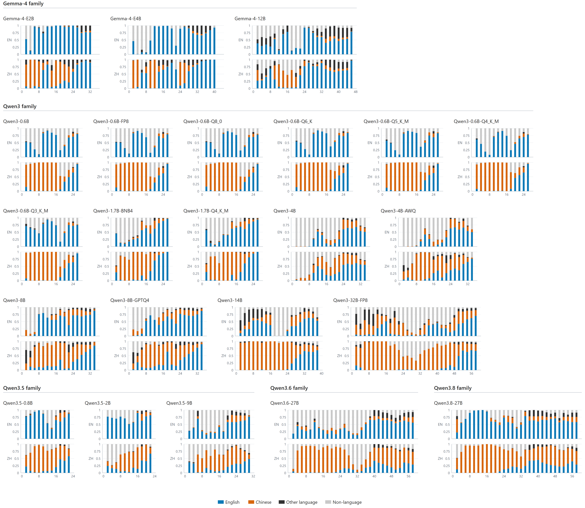
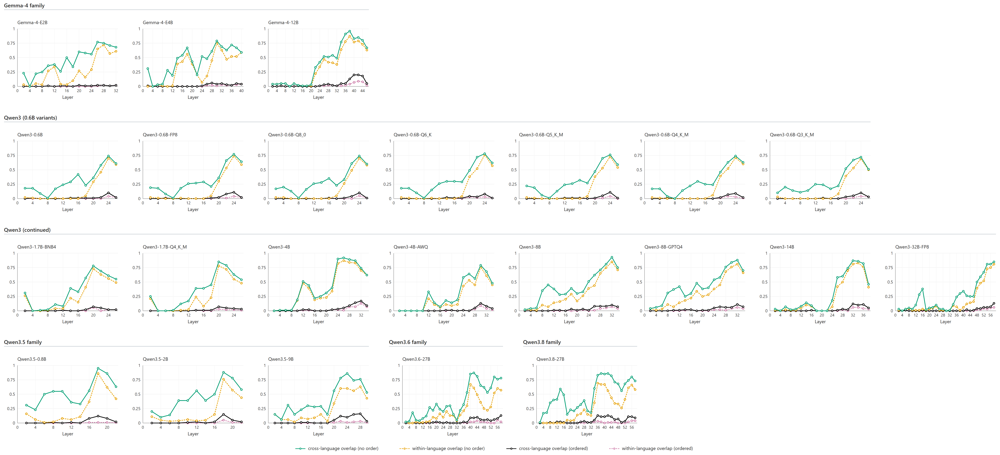
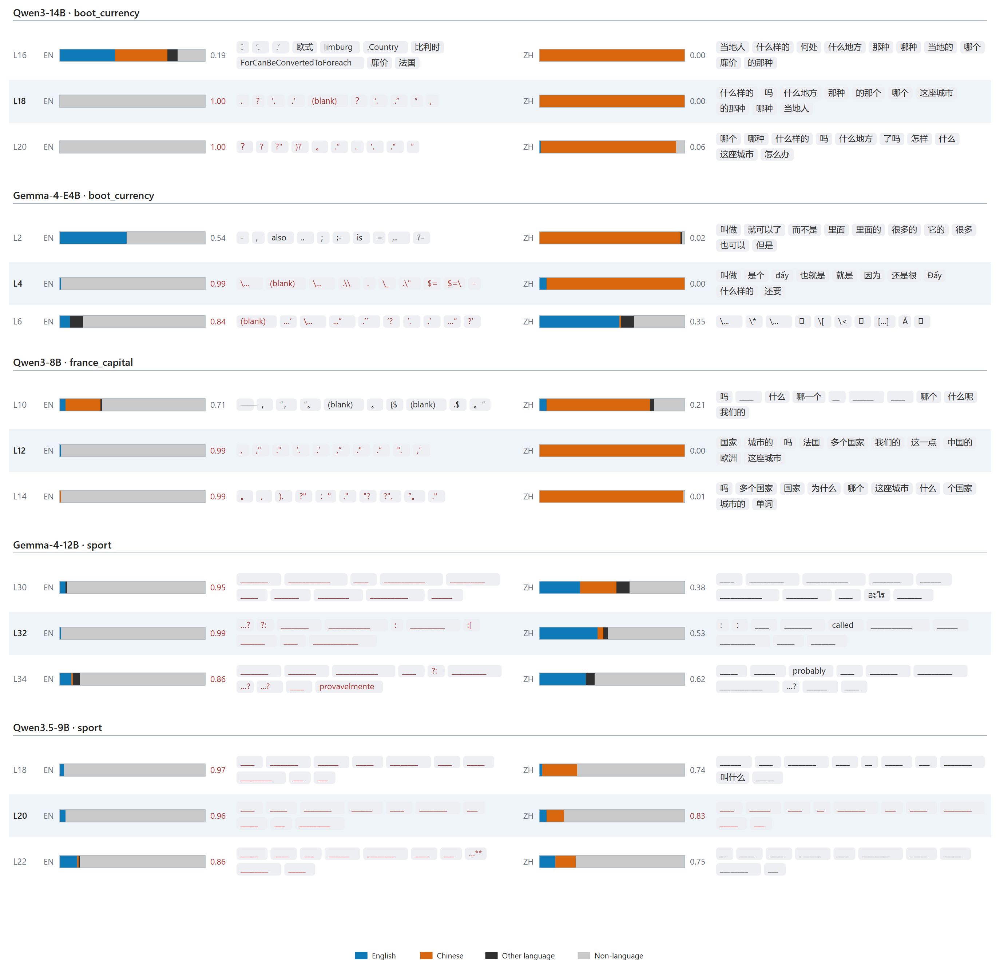

## J-Prism: Language Models Think Semantically, with Preferred Languages

With the exact same **prompt**, **model**, and **layer**, Qwen and Gemma models were probed with **Chinese** J-lenses and **English** J-lenses.

The results could indicate:

| Interpretation | Evidence |
| --- | --- |
| The lens has a preference for languages | Each lens usually gives the larger share to the language it was fitted on. |
| The model has a preference for languages | The lens fitted on the model's own language usually reads a purer share of it than the other lens does. |
| The thinking has a preference for languages | A blackout usually falls on one lens while the other still reads. |
| The thinking is semantic | The two pools overlap in meaning across the two fitted languages and a small minority of other languages. |



**Figure 1.** Language composition of the candidate pools of both lenses. Currency probe at the last position, top-100 candidates; the four bands sum to one at every layer.



**Figure 2.** Overlap between the candidate lists of the two lenses. Four measures per model on the currency probe at the last position, top-100 candidates.



**Figure 3.** Blackouts in five (model, probe) cells over three consecutive measured layers. Each bar gives the composition of that lens's top-100 pool; the ten highest-ranked candidates stand beside it.

## Pipeline

Two lenses per model, one per corpus, measured on the same probes and audited per cell. The code is in `src/`; per-lens provenance is in `cards/`.

1. **Corpora.** Two corpora of 1,000 non-overlapping 128-token windows, cut in stream order with the Qwen3-0.6B tokenizer: English WikiText-103 and Chinese Wikipedia (`20231101.zh`). The Chinese build adds Han-ratio guards, and both drop any window that contains a probe string or a listed answer paraphrase.
2. **Fit.** One lens per corpus per model, the Jacobian of the final-layer output with respect to an earlier residual stream, averaged over the 1,000 fitting windows in fp32 with every second source layer sampled. A prompt with a non-finite Jacobian is skipped, and a lens above 2% skips is refused. Entry point `src/measure/run_fit_sicc.py`; the registry in that file covers five families from 0.6B to 32B, with quantized variants as separate rungs.
3. **Measure.** Each lens is applied to the same four English probes at the last position of every scored layer, and the top-100 candidates are stored per cell with the answer rank. Entry point `src/measure/measure_sicc.py`; probes and ranks are fixed in `src/measure/pilot_core.py`.
4. **Score.** Hit@5 and Hit@10 per cell; the language composition of each pool (English, Chinese, other language, non-language); blackouts, a top-5 pool with no language token; and cross-language overlap, with and without order, over a bilingual lexicon (`src/analysis/bilingual_align.py`).
5. **Audit.** `src/audit/full_audit.py` joins four states per (model, corpus): lens file, measurement, prompt compliance, and fit card. A rung counts only when all four hold.

The fitted lenses and raw measurements are local (about 31 GB) and not in git; the code reproduces them from the corpora.

## Reproduce

```bash
pip install -e "git+https://github.com/anthropics/jacobian-lens#egg=jlens"
python src/measure/run_fit_sicc.py --model qwen3-0.6b
python src/measure/measure_sicc.py --only qwen3-0.6b
python src/audit/full_audit.py experiment/lenses/local experiment/RESULT/MEASURE_SICC
```

The quoted `pip` line matters: an unquoted `#egg=jlens` is a shell comment.

## References

Gurnee, W., et al. (2026). *Verbalizable Representations Form a Global Workspace in Language Models.* Jacobian-lens library: <https://github.com/anthropics/jacobian-lens>, Apache-2.0.

Merity, S., Xiong, C., Bradbury, J., and Socher, R. (2017). *Pointer Sentinel Mixture Models.* WikiText-103, used here as `Salesforce/wikitext`, config `wikitext-103-raw-v1`, train split.

Wikimedia Foundation. Chinese Wikipedia dump `wikimedia/wikipedia`, config `20231101.zh`.

## License

Apache-2.0 covers everything in this repository. The upstream Jacobian-lens library is Anthropic's, also Apache-2.0, and is a declared dependency. The lens algorithm stays in that library.

If you use the code, cite `CITATION.cff`.

## Author

Code and analyses: Zhengyuan Liu. The full author list is in the accompanying paper.
