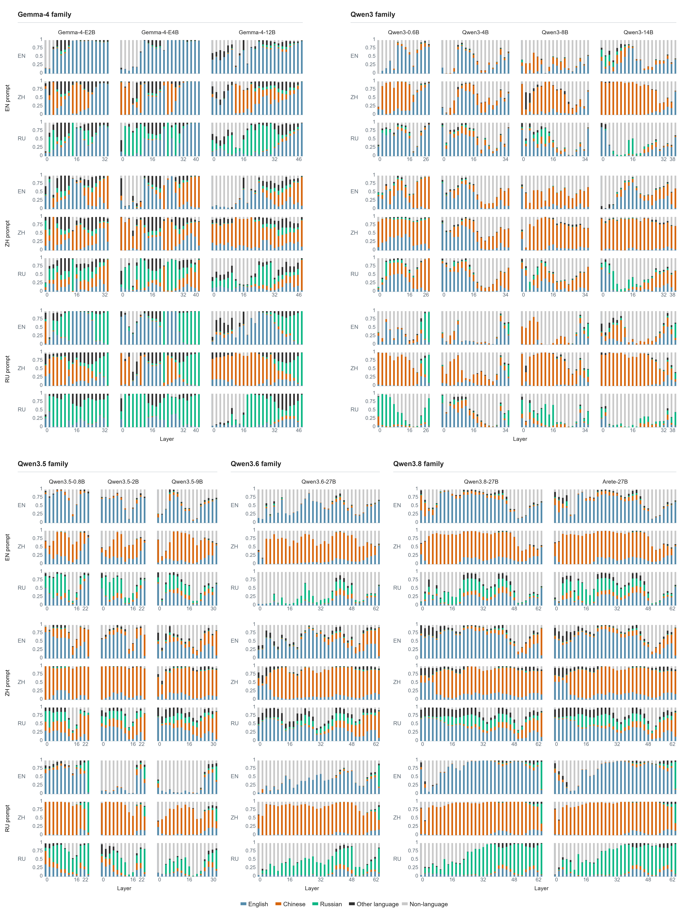
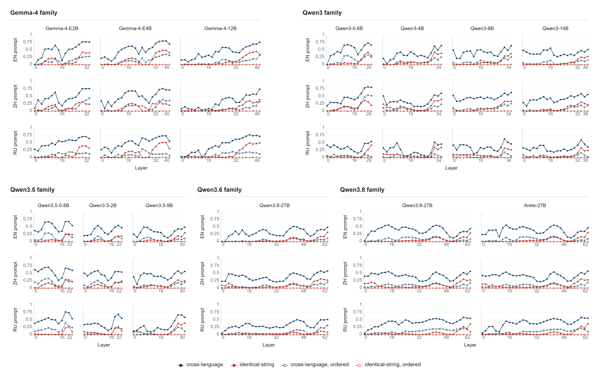
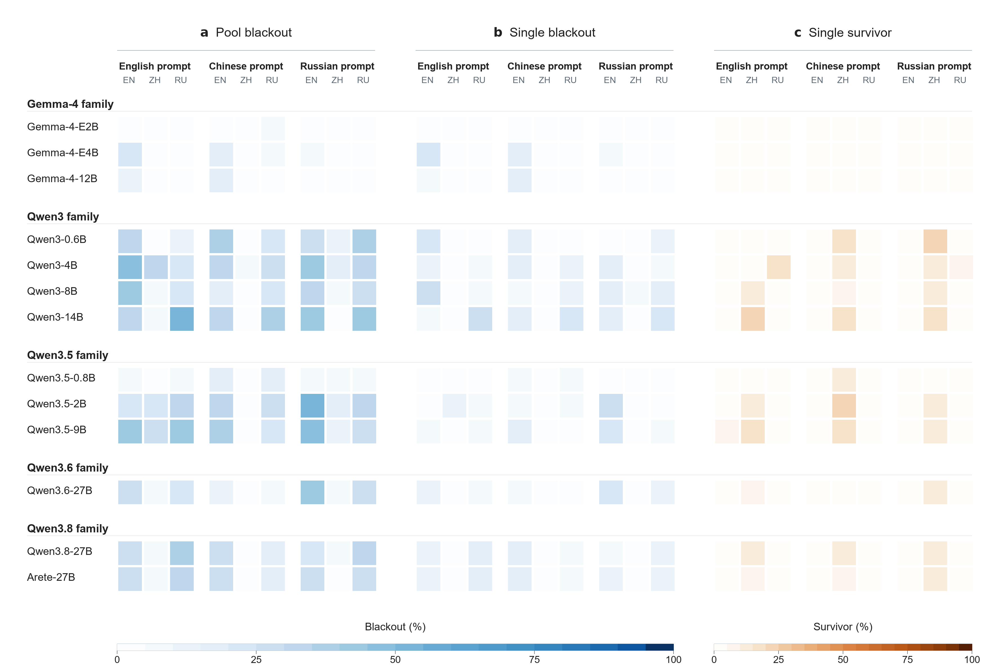
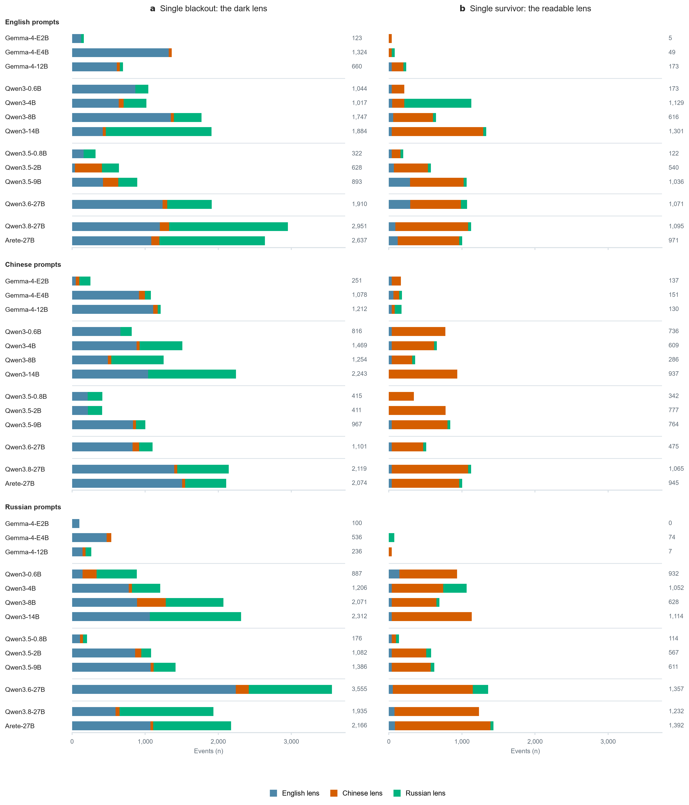

## Thinks Like a Bilingual: Language Models Have Their Preferred Languages in the Global Workspace

Project J-Prism fits Jacobian lenses on English, Chinese and Russian materials, measures what each lens reads, and compares the three readings. A J-lens is the Jacobian of the final-layer output with respect to an intermediate layer, averaged over a fitting corpus of 1,000 sequences of 128 tokens. The paper covers thirteen checkpoints from five model families, 0.6B to 27B parameters: three lenses per checkpoint, 39 lenses, and 900 prompts run through every lens.

## What have we found

With the same prompt, model and layer held fixed, thirteen Qwen and Gemma checkpoints were probed with English-, Chinese- and Russian-fitted J-lenses. The results could indicate:

| Interpretation | Evidence |
| --- | --- |
| The lens has a preference for languages | Each lens usually gives its largest share to the language of its fitting corpus. |
| The model has a preference for languages | Which language a lens reads most cleanly depends on the model as well as the lens. |
| The thinking has a preference for languages | A blackout usually falls on one lens while the other two still read. |
| The thinking is semantic | The three candidate lists overlap in meaning across the fitted languages, and translation-linked matches far exceed identical strings. |

**Figure 1. Language composition for all checkpoints of the five model groups. Rows are the prompt language: English, Chinese and Russian. Columns are the checkpoints, with every measured model of each family shown: three for Gemma-4, four for Qwen3, three for Qwen3.5, one for Qwen3.6 and two for Qwen3.8 (Qwen3.8-27B and Arete-27B). Each checkpoint has three rows, one for each lens the readout was fitted on (English, Chinese and Russian), and panel width follows the number of measured layers. One bar is one measured layer, and the five bands (English, Chinese, Russian, other language, non-language) add to one in every bar. The probes are the 100 country–capital (P1) items, read from the top-100 candidates at the last prompt position. All thirteen checkpoints enter the fixed-effect models of Section 2.5, which use all 300 probes.**

**Figure 2.** Three-way overlap between the three lenses by layer, for all checkpoints of the five model groups. Each family block has one row per prompt language (English, Chinese and Russian) and one panel per checkpoint, covering every measured model: three panels for Gemma-4, four for Qwen3, three for Qwen3.5, one for Qwen3.6 and two for Qwen3.8 (Qwen3.8-27B and Arete-27B). Panel width follows the number of measured layers. Four overlap measures are plotted across the measured layers: cross-language, ordered cross-language, identical-string and ordered identical-string overlap. A candidate counts only when both other lens lists carry a match, either the identical string or a linked translation; the four measures follow the definitions in the Phenomena section. Cross-language overlap is generally the highest across layers and tends to increase with depth, with local dips; the ordered cross-language and identical-string curves sit below it, and ordered identical-string overlap remains near zero. The data are the 300 probes, 100 per family, from the top-100 pools at the last prompt position, with one point per measured layer.

**Figure 3.** Blackout rates for the thirteen models, the three lenses and the three prompt languages. Each panel shows one outcome. Pool blackout marks a pool as dark when its top-10 candidates carry no letter-bearing token and at least half of its top-100 slots are non-language. Single blackout counts layers where exactly one lens is dark and the other two read; single survivor counts layers where exactly one lens reads and the other two are dark. Rows are models grouped by family, the nine columns are grouped by prompt language (English, Chinese, Russian) with the three lenses as sub-columns (EN, ZH, RU), each entry gives the model-averaged proportion of measured layers, shading uses one shared 0-100% scale quantized in 5% steps, with a blue ramp for the two blackout panels and a warm ramp for the survivor panel, and rows are ordered by family and checkpoint size. Data are the 300 probes and the 100-candidate pools at the last prompt position.

**Figure 4. Composition of single-blackout and single-survivor events by prompt language. (a) Proportion of single-blackout events whose single dark lens was the English (blue), Chinese (orange) or Russian (green) lens, for each model, separately for English, Chinese and Russian prompts. (b) Proportion of single-survivor events by the lens that remained readable. Bars are stacked event counts, so bar length gives the number of events (also printed to the right of each bar) and each segment gives that lens's proportion of them. Slices below 40 events are drawn at a minimum visible width so that the smallest segments stay visible. Models are grouped by family. Events are defined on the 300 probes at the last prompt position and pooled over probes and measured layers within each prompt language: single blackout counts layers on which exactly one lens is dark and the other two read; single survivor counts layers on which exactly one lens reads and the other two are dark. The dark/read criterion is the pool-blackout criterion of Section 2.4 (top-10 candidates all non-language and non-language proportion of the top-100 at least 50%).**

Per-layer supplementary figures are collected in [supplementary/figures/FIGURES.md](supplementary/figures/FIGURES.md). Tidy supplementary tables (contrasts, cell means, omnibus terms, post-training comparison) are in [supplementary/](supplementary/README.md), with the file inventory in [supplementary/MANIFEST.md](supplementary/MANIFEST.md).

## Method
### Model list

The paper measures the thirteen non-quantized checkpoints, shown in bold. The quantized and FP8 entries are precision controls from a separate experiment and do not enter the analyses.

| Model family | Checkpoint | Params | Layers | d_model | Attention | Weights |
| --- | --- | --- | --- | --- | --- | --- |
| Qwen3 | **Qwen3-0.6B** | 0.6B | 28 | 1024 | full | bf16 |
| | Qwen3-0.6B-FP8 | 0.6B | 28 | 1024 | full | FP8 |
| | Qwen3-0.6B-Q8_0 | 0.6B | 28 | 1024 | full | GGUF Q8_0 |
| | Qwen3-0.6B-Q6_K | 0.6B | 28 | 1024 | full | GGUF Q6_K |
| | Qwen3-0.6B-Q5_K_M | 0.6B | 28 | 1024 | full | GGUF Q5_K_M |
| | Qwen3-0.6B-Q4_K_M | 0.6B | 28 | 1024 | full | GGUF Q4_K_M |
| | Qwen3-0.6B-Q3_K_M | 0.6B | 28 | 1024 | full | GGUF Q3_K_M |
| | Qwen3-0.6B-Q2_K | 0.6B | 28 | 1024 | full | GGUF Q2_K |
| | Qwen3-1.7B-BNB4 | 1.7B | 28 | 2048 | full | bitsandbytes 4-bit |
| | Qwen3-1.7B-Q4_K_M | 1.7B | 28 | 2048 | full | GGUF Q4_K_M |
| | Qwen3-1.7B-Q3_K_M | 1.7B | 28 | 2048 | full | GGUF Q3_K_M |
| | Qwen3-1.7B-Q2_K | 1.7B | 28 | 2048 | full | GGUF Q2_K |
| | **Qwen3-4B** | 4B | 36 | 2560 | full | bf16 |
| | Qwen3-4B-AWQ | 4B | 36 | 2560 | full | AWQ |
| | **Qwen3-8B** | 8B | 36 | 4096 | full | bf16 |
| | Qwen3-8B-GPTQ-Int4 | 8B | 36 | 4096 | full | GPTQ-Int4 |
| | **Qwen3-14B** | 14B | 40 | 5120 | full | bf16 |
| | Qwen3-32B-FP8 | 32B | 64 | 5120 | full | FP8 |
| Qwen3.5 | **Qwen3.5-0.8B** | 0.8B | 24 | 1024 | linear | bf16 |
| | Qwen3.5-0.8B-FP8 | 0.8B | 24 | 1024 | linear | FP8 |
| | Qwen3.5-0.8B-Q8_0 | 0.8B | 24 | 1024 | linear | GGUF Q8_0 |
| | Qwen3.5-0.8B-Q6_K | 0.8B | 24 | 1024 | linear | GGUF Q6_K |
| | Qwen3.5-0.8B-Q5_K_M | 0.8B | 24 | 1024 | linear | GGUF Q5_K_M |
| | Qwen3.5-0.8B-Q4_K_M | 0.8B | 24 | 1024 | linear | GGUF Q4_K_M |
| | Qwen3.5-0.8B-Q4_K_S | 0.8B | 24 | 1024 | linear | GGUF Q4_K_S |
| | Qwen3.5-0.8B-Q3_K_M | 0.8B | 24 | 1024 | linear | GGUF Q3_K_M |
| | Qwen3.5-0.8B-Q2_K | 0.8B | 24 | 1024 | linear | GGUF Q2_K |
| | **Qwen3.5-2B** | 2B | 24 | 2048 | linear | bf16 |
| | Qwen3.5-2B-Q4_K_S | 2B | 24 | 2048 | linear | GGUF Q4_K_S |
| | Qwen3.5-2B-Q4_K_M | 2B | 24 | 2048 | linear | GGUF Q4_K_M |
| | Qwen3.5-2B-Q3_K_M | 2B | 24 | 2048 | linear | GGUF Q3_K_M |
| | Qwen3.5-2B-Q2_K | 2B | 24 | 2048 | linear | GGUF Q2_K |
| | **Qwen3.5-9B** | 9B | 32 | 4096 | linear | bf16 |
| Qwen3.6 | **Qwen3.6-27B** | 27B | 64 | 5120 | hybrid 3:1 | bf16 |
| Qwen3.8 | **Qwen3.8-27B** | 27B | 64 | 5120 | hybrid 3:1 | bf16 |
| | **Arete-27B** | 27B | 64 | 5120 | hybrid 3:1 | bf16 |
| Gemma-4 | **Gemma-4-E2B** | E2B | 35 | 1536 | — | bf16 |
| | **Gemma-4-E4B** | E4B | 42 | 2560 | — | bf16 |
| | **Gemma-4-12B** | 12B | 48 | 3840 | — | bf16 |

### Probes

PROBE300 contains 100 variants of each of three probe families (300 probes in total), and every probe is asked in English, Chinese and Russian. The table gives variant 0 of each family; the other variants change the entity or the cue and keep the answer type.

| Probe family | English prompt | Chinese prompt | Russian prompt | Answer targets |
| --- | --- | --- | --- | --- |
| P1, country–capital | `The capital of France is` | `法国的首都是` | `Столица Франции — это` | paris / 巴黎 / париж |
| P3, definitional (body-part counting) | `The number of legs on the animal that spins webs is` | `会织网的动物身上的腿的数量是` | `Количество ног у животного, которое плетёт сети — это` | 8, eight / 八 / 8, восемь |
| P4, category–clue (category completion) | `Think of a sport: people kick a round ball into a net. The sport is` | `想一项运动：人们把一个圆球踢进网里。这项运动是` | `Подумайте о виде спорта: люди пинают круглый мяч в ворота. Этот вид спорта —` | football, soccer / 足球 / футбол |

The currency probe (P2) did not yield 100 probes and was not included, leaving 300 probes.

### Phenomena

| Category | Variable | Definition |
| --- | --- | --- |
| composition | average band share | The proportion of the top-100 candidates carrying each of the five labels (English, Chinese, Russian, other language, non-language), averaged over the measured layers; the five shares sum to one. |
| blackout | pool blackout | The proportion of measured layers at which a lens is dark: its top-10 candidates carry no letter-bearing token and at least half of its top-100 candidates are non-language. |
|  | single blackout | The proportion of layers at which exactly one of the three lenses is dark and the other two read. |
|  | single survivor | The proportion of layers at which exactly one of the three lenses reads and the other two are dark. |
| semantic overlap | cross-language overlap | The proportion of the three lenses' top-100 candidates that correspond to at least one candidate in each of the other two lists (identical strings or translation-linked). |
|  | ordered cross-language overlap | The proportion of ranks at which all three lenses place corresponding candidates. |
|  | identical-string overlap | The proportion of identical strings common to all three lists. |
|  | ordered identical-string overlap | The proportion of ranks at which all three lenses place the identical string. |

### Statistical analysis

Each of the thirteen models was analyzed separately. The composition model treated the four ILR coordinates as a multivariate response, with prompt language, lens language and probe family and all interactions as fixed factors, an independent probe intercept for each coordinate, and a full residual covariance across coordinates; a full 4×4 probe-covariance model was fitted as a sensitivity analysis. Pool blackout used an arcsine LMM with Type III Satterthwaite tests and Bonferroni-corrected simple effects, confirmed by a Bayesian binomial model on the dark-layer counts. The four overlap measures were stacked into one beta-binomial model with overlap type, prompt language and probe family and all interactions, a probe intercept, and one overdispersion parameter per model. Single-blackout and single-survivor compositions are descriptive, with Wilson 95% confidence intervals. All models were fitted in R 4.4.1, with brms 2.23.0 and rstan 2.32.7 for the Bayesian models and lme4 2.0-1, lmerTest 3.2-1 and emmeans 1.10-1 for the arcsine LMM. Analyses were called from Python through rpy2.

## References

Gurnee, W., et al. (2026). *Verbalizable Representations Form a Global Workspace in Language Models.* Jacobian-lens library: <https://github.com/anthropics/jacobian-lens>, Apache-2.0.

Merity, S., Xiong, C., Bradbury, J., and Socher, R. (2017). *Pointer Sentinel Mixture Models.* WikiText-103, used here as `Salesforce/wikitext`, config `wikitext-103-raw-v1`, train split.

Wikimedia Foundation. Chinese Wikipedia dump `wikimedia/wikipedia`, config `20231101.zh`.

Wikimedia Foundation. Russian Wikipedia dump `wikimedia/wikipedia`, config `20231101.ru`.

## Citation

If you use this code, please cite it as below:

Liu, Z., Nelyubina, M., Myachykov, A., and Zhang, H. (2026). *jprism-bilingual: English-, Chinese- and Russian-fitted Jacobian lenses across thirteen checkpoints.* Software. <https://github.com/Paradeluxe/jprism-bilingual>

The machine-readable record is in [`CITATION.cff`](CITATION.cff).

## Acknowledgement

This work was conducted by **Zhengyuan Liu**, PhD student of **Prof. Haoyun Zhang**'s Lab, and **Maria Nelyubina**, PhD student of **Prof. Andriy Myachykov**'s Lab. All named contributors are affiliated with the Centre for Cognitive and Brain Sciences, Institute of Artificial Intelligence and Brain Sciences, University of Macau.

This work was performed in part at SICC which is supported by IOTSC of the University of Macau.
