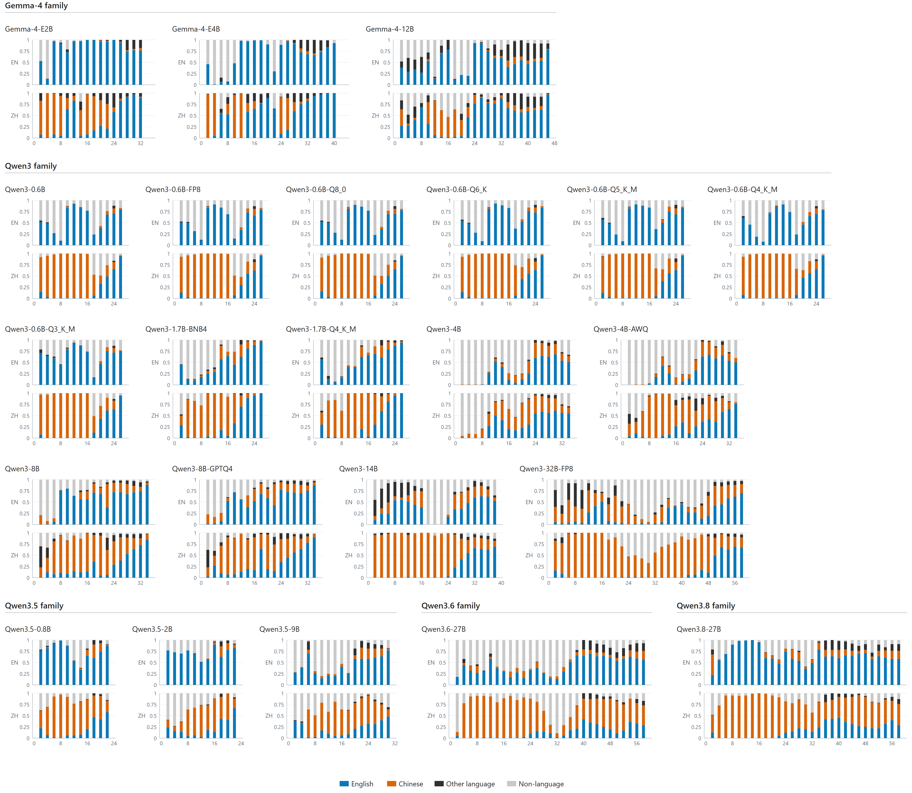
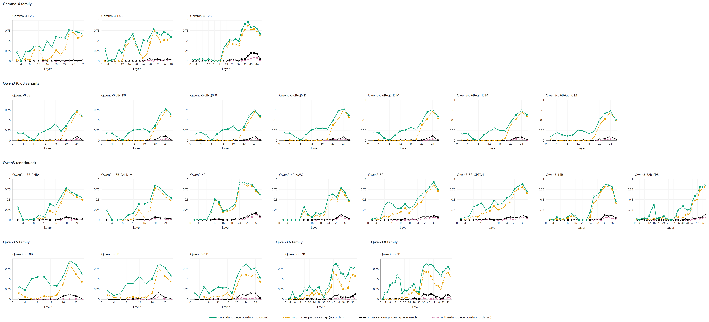
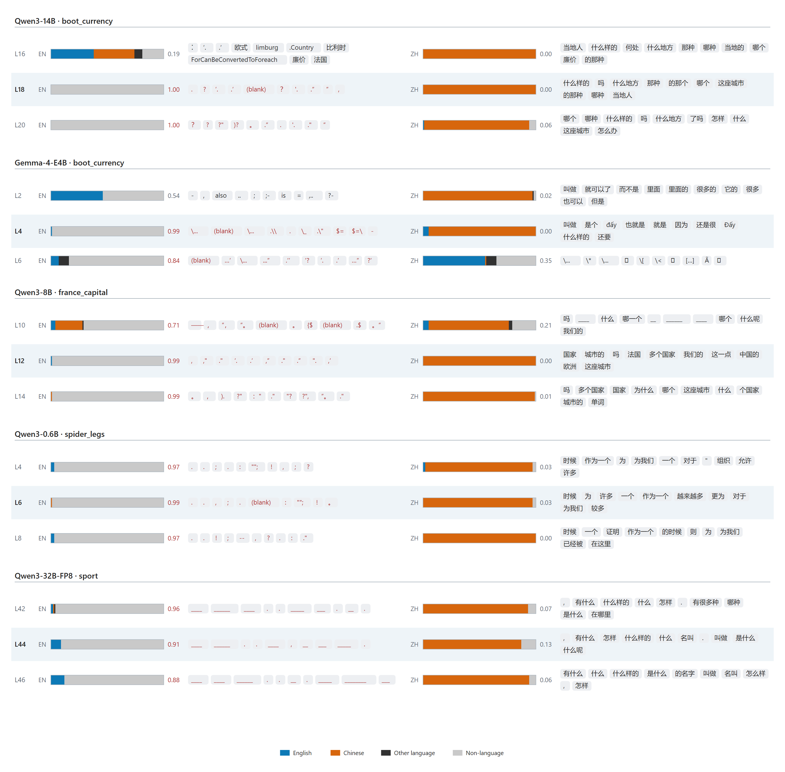
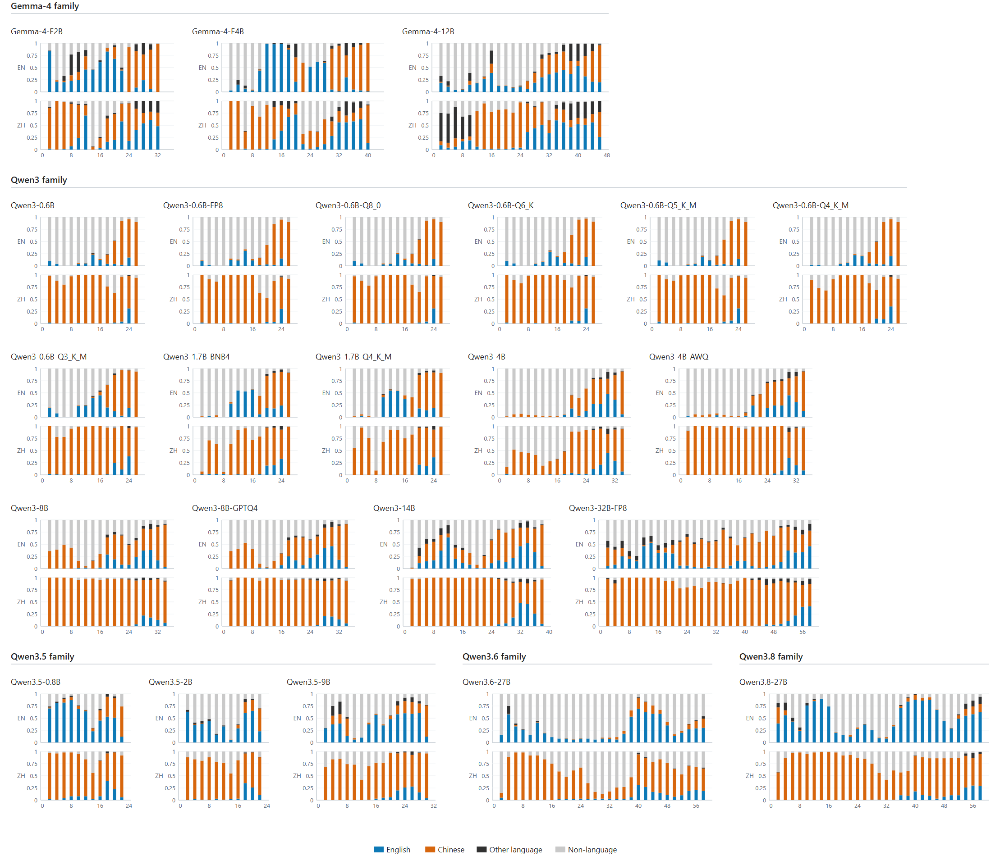
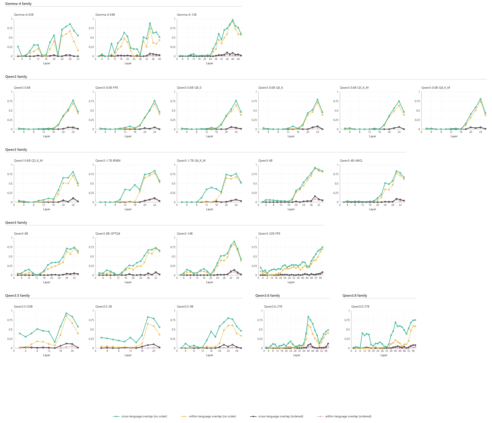
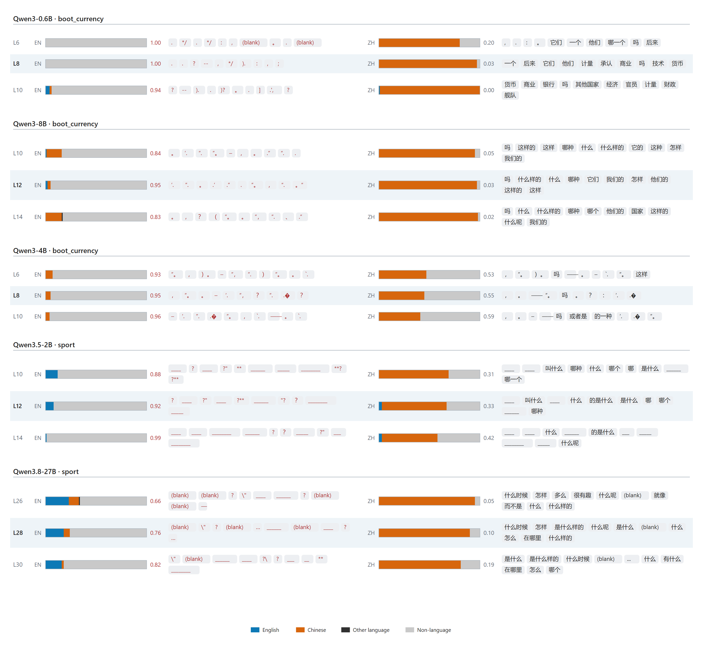

## J-Prism: Language Models Think Semantically, with Preferred Languages

Project J-Prism fits Jacobian lenses on English, Chinese, and Russian materials, measures what each lens reads, and compares the three readings. A J-lens is the Jacobian of the final-layer output with respect to an intermediate layer, averaged over a fitting corpus of 1,000 sequences of 128 tokens. 

## What have we found

With the exact same **prompt**, **model**, and **layer**, Qwen and Gemma models were probed with **Chinese**, **English** and **Russian** J-lenses. The results could indicate:

| Interpretation | Evidence |
| --- | --- |
| The lens has a preference for languages | Each lens usually gives the larger share to the language it was fitted on. |
| The model has a preference for languages | The lens fitted on the model's own language usually reads a purer share of it than the other lens does. |
| The thinking has a preference for languages | A blackout usually falls on one lens while the other still reads. |
| The thinking is semantic | The two candidate lists overlap in meaning across the two fitted languages and a small minority of other languages. |




**Figure 1.** Language composition of the candidate pools of both lenses. Currency probe at the last position, top-100 candidates; the four bands sum to one at every layer.



**Figure 2.** Overlap between the candidate lists of the two lenses. Four measures per model on the currency probe at the last position, top-100 candidates.



**Figure 3.** Blackouts in five (model, probe) cells over three consecutive measured layers. Each bar gives the composition of that lens's top-100 pool; the ten highest-ranked candidates stand beside it. The English-fitted lens is dark at all fifteen of these layers while the Chinese-fitted lens keeps proposing readable candidates at the same layers: its non-language share runs 0.83-1.00 against 0.00-0.13 on the other side.

The sixty-three appendix figures — per-layer trajectories of both lenses at candidate depths 100, 5 and 10, plus the four overlap measures on the remaining three probes — are collected in [`docs/APPENDIX_FIGURES.md`](docs/APPENDIX_FIGURES.md).

## Chinese probes

The four probes were also asked in Chinese (`ZH_CLASSIC`, the hard translation used for the zh prompt set), with the models, the layers and both lenses unchanged; the measurements are in `experiment/results/zhprompt/`. The three readings below repeat Figures 1–3 under the Chinese probes, on the same 23 checkpoints.



**Figure 4.** Language composition of the candidate pools of both lenses under the Chinese probes (EN = English-fitted lens, ZH = Chinese-fitted lens). Currency probe at the last position, top-100 candidates; same layout as Figure 1. Averaged over the 23 checkpoints, the Chinese-fitted lens is more Chinese than under the English probes (Chinese share 0.75 vs 0.56), while the English-fitted lens keeps only 0.22 English share (0.52 under the English probes) and turns 50% non-language; each lens nonetheless leads on its own language relative to the other lens.



**Figure 5.** Overlap between the candidate lists of the two lenses under the Chinese probes, in the four measures and the layout of Figure 2. The unordered cross-language and within-language coverage rise together in the late layers, as they do under the English probes; the ordered measures stay low.



**Figure 6.** Blackouts under the Chinese probes, in five (model, probe) cells over three consecutive measured layers, in the layout of Figure 3. The one-sided pattern survives the change of prompt language: the English-fitted lens goes dark at all fifteen layers (non-language share 0.66-1.00) while the Chinese-fitted lens keeps proposing readable candidates throughout (0.00-0.59).

Taken with Figures 4–6, the Chinese probes repeat the two robust observations of the English probes: the candidate lists overlap through translations more than through shared strings, and blackouts fall on the English-fitted lens while the Chinese-fitted lens keeps reading. The composition of each pool, by contrast, moves with the language of the probe.

## Method
### Model list

| Family | Checkpoint | Params | Layers | d_model | Attention | Weights |
| --- | --- | --- | --- | --- | --- | --- |
| Qwen3 | Qwen3-0.6B | 0.6B | 28 | 1024 | full | bf16 |
| | Qwen3-0.6B-FP8 | 0.6B | 28 | 1024 | full | FP8 |
| | Qwen3-0.6B-Q8_0 | 0.6B | 28 | 1024 | full | GGUF Q8_0 |
| | Qwen3-0.6B-Q6_K | 0.6B | 28 | 1024 | full | GGUF Q6_K |
| | Qwen3-0.6B-Q5_K_M | 0.6B | 28 | 1024 | full | GGUF Q5_K_M |
| | Qwen3-0.6B-Q4_K_M | 0.6B | 28 | 1024 | full | GGUF Q4_K_M |
| | Qwen3-0.6B-Q3_K_M | 0.6B | 28 | 1024 | full | GGUF Q3_K_M |
| | Qwen3-0.6B-Q2_K | 0.6B | 28 | 1024 | full | GGUF Q2_K |
| | Qwen3-1.7B-BNB4 | 1.7B | 28 | 2048 | full | bitsandbytes 4-bit |
| | Qwen3-1.7B-Q4_K_M | 1.7B | 28 | 2048 | full | GGUF Q4_K_M |
| | Qwen3-1.7B-Q3_K_M | 1.7B | 28 | 2048 | full | GGUF Q3_K_M |
| | Qwen3-1.7B-Q2_K | 1.7B | 28 | 2048 | full | GGUF Q2_K |
| | Qwen3-4B | 4B | 36 | 2560 | full | bf16 |
| | Qwen3-4B-AWQ | 4B | 36 | 2560 | full | AWQ |
| | Qwen3-8B | 8B | 36 | 4096 | full | bf16 |
| | Qwen3-8B-GPTQ-Int4 | 8B | 36 | 4096 | full | GPTQ-Int4 |
| | Qwen3-14B | 14B | 40 | 5120 | full | bf16 |
| | Qwen3-32B-FP8 | 32B | 64 | 5120 | full | FP8 |
| Qwen3.5 | Qwen3.5-0.8B | 0.8B | 24 | 1024 | linear | bf16 |
| | Qwen3.5-0.8B-FP8 | 0.8B | 24 | 1024 | linear | FP8 |
| | Qwen3.5-0.8B-Q8_0 | 0.8B | 24 | 1024 | linear | GGUF Q8_0 |
| | Qwen3.5-0.8B-Q6_K | 0.8B | 24 | 1024 | linear | GGUF Q6_K |
| | Qwen3.5-0.8B-Q5_K_M | 0.8B | 24 | 1024 | linear | GGUF Q5_K_M |
| | Qwen3.5-0.8B-Q4_K_M | 0.8B | 24 | 1024 | linear | GGUF Q4_K_M |
| | Qwen3.5-0.8B-Q4_K_S | 0.8B | 24 | 1024 | linear | GGUF Q4_K_S |
| | Qwen3.5-0.8B-Q3_K_M | 0.8B | 24 | 1024 | linear | GGUF Q3_K_M |
| | Qwen3.5-0.8B-Q2_K | 0.8B | 24 | 1024 | linear | GGUF Q2_K |
| | Qwen3.5-2B | 2B | 24 | 2048 | linear | bf16 |
| | Qwen3.5-2B-Q4_K_S | 2B | 24 | 2048 | linear | GGUF Q4_K_S |
| | Qwen3.5-2B-Q4_K_M | 2B | 24 | 2048 | linear | GGUF Q4_K_M |
| | Qwen3.5-2B-Q3_K_M | 2B | 24 | 2048 | linear | GGUF Q3_K_M |
| | Qwen3.5-2B-Q2_K | 2B | 24 | 2048 | linear | GGUF Q2_K |
| | Qwen3.5-9B | 9B | 32 | 4096 | linear | bf16 |
| Qwen3.6 | Qwen3.6-27B | 27B | 64 | 5120 | hybrid 3:1 | bf16 |
| Qwen3.8 | Qwen3.8-27B | 27B | 64 | 5120 | hybrid 3:1 | bf16 |
| Gemma-4 | Gemma-4-E2B | E2B | 35 | 1536 | — | bf16 |
| | Gemma-4-E4B | E4B | 42 | 2560 | — | bf16 |
| | Gemma-4-12B | 12B | 48 | 3840 | — | bf16 |
### Corpora

| Corpus | Source | Config | Windows | sha256 of built file |
| --- | --- | --- | --- | --- |
| English | [`Salesforce/wikitext`](https://huggingface.co/datasets/Salesforce/wikitext) | `wikitext-103-raw-v1`, train | 1,000 × 128 | `dacf54ddf125c2d906e0b5634cfc95972decc75a0843933d1fb2aad2795a21ee` |
| Chinese | [`wikimedia/wikipedia`](https://huggingface.co/datasets/wikimedia/wikipedia) | `20231101.zh` | 1,000 × 128 | `f1b108c43abbabb1acc5c44ae18633b1daebe657b9f44aa393548974cbbd2792` |
### Probes

| Probe | Prompt | Prompt (Chinese) | Rank targets |
| --- | --- | --- | --- |
| P1 | `Fact: The currency used in the country shaped like a boot is` | `事实：形似靴子的国家所使用的货币是` | euro, eur / 欧元 |
| P2 | `The number of legs on the animal that spins webs is` | `会织网的动物身上的腿的数量是` | 8, eight / 八 |
| P3 | `The capital of France is` | `法国的首都是` | paris / 巴黎 |
| P4 | `Think of a sport: people kick a round ball into a net. The sport is` | `想一项运动：人们把一个圆球踢进网里。这项运动是` | football, soccer / 足球 |
### Phenomena

| Category | Variable | Level | Operational definition |
| --- | --- | --- | --- |
| language share | average language share | model | The share of the J-lens top-100 candidates, averaged over the measured layers. |
| blackout | average blackout | model | The proportion of measured layers at which the lens is dark, i.e. all of its top-10 candidates, and more than 50% of its top-100 candidates carry non-language tokens. |
|  | single-lens blackout | layer | The proportion of layers at which exactly one of the three lenses is dark and the other two read. |
|  | single-lens lucidity | layer | The proportion of layers at which exactly one of the three lenses is not dark and the other two are dark. |
| semantic overlap | cross-language overlap without order | three lenses | The share of the three lenses' top-100 candidates that correspond to at least one candidate in each of the other two lists (identical strings or translation-linked). |
|  | cross-language overlap with order | three lenses | The share of ranks at which all three lenses place corresponding candidates. |
|  | within-language overlap without order | three lenses | The share of identical strings common to all three lists. |
|  | within-language overlap with order | three lenses | The share of ranks at which all three lenses place the identical string. |

### Statistical analysis

Each model was analysed separately at the item level, with item (the 300 probes) as a random intercept and prompt language (EN, ZH, RU) × lens language (EN, ZH, RU) as fixed factors. Every share is a **top-100** pool share, averaged over the measured step-2 layers with layer 0 excluded; it is not a top-5 or top-10 share.

Three groups of dependent variables were used: the four language shares; the blackout rates (pool blackout, single blackout and single survivor); and four three-lens overlap measures (cross-language vs identical-string, unordered and ordered, each requiring agreement among all three lenses). The generic models were (the asterisk denotes a full model, i.e. both main effects and their interaction; `(1 | Probe)` is a random intercept for the 300 probes):

```
LanguageShare   ~ PromptLanguage * LensLanguage + (1 | Probe)
BlackoutRate    ~ PromptLanguage * LensLanguage + (1 | Probe)
SemanticOverlap ~ PromptLanguage + (1 | Probe)
```

LanguageShare is the top-100 language share, arcsine-square-root transformed before the linear mixed model was fitted; BlackoutRate and SemanticOverlap are proportions modelled as binomial counts with a logit link. The overlap model contains prompt language as the only fixed factor because the three lenses are combined by construction. Simple effects were tested with joint tests of prompt language within each lens level and of lens language within each prompt level, followed by Bonferroni pairwise contrasts; Holm correction within a dependent variable changed no inference. Models were fitted in R with lme4 and lmerTest (Satterthwaite degrees of freedom), with car and emmeans for tests and contrasts, called from Python through rpy2 and ezlmm. The overlap analyses are descriptive: no randomised baseline was computed.


## References

Gurnee, W., et al. (2026). *Verbalizable Representations Form a Global Workspace in Language Models.* Jacobian-lens library: <https://github.com/anthropics/jacobian-lens>, Apache-2.0.

Merity, S., Xiong, C., Bradbury, J., and Socher, R. (2017). *Pointer Sentinel Mixture Models.* WikiText-103, used here as `Salesforce/wikitext`, config `wikitext-103-raw-v1`, train split.

Wikimedia Foundation. Chinese Wikipedia dump `wikimedia/wikipedia`, config `20231101.zh`.

## Citation

If you use this code, please cite it as below:

Liu, Z., Nelyubina, M., Myachykov, A., and Zhang, H. (2026). *jprism-bilingual: controlled comparison of English- and Chinese-fitted Jacobian lenses.* Software. <https://github.com/Paradeluxe/jprism-bilingual>

The machine-readable record is in [`CITATION.cff`](CITATION.cff).

## Acknowledgement

This work was conducted by **Zhengyuan Liu**, PhD student of **Prof. Haoyun Zhang**'s Lab, and **Maria Nelyubina**, PhD student of **Prof. Andriy Myachykov**'s Lab. All named contributors are affiliated with the Centre for Cognitive and Brain Sciences, Institute of Artificial Intelligence and Brain Sciences, University of Macau.

This work was performed in part at SICC which is supported by IOTSC of the University of Macau.
