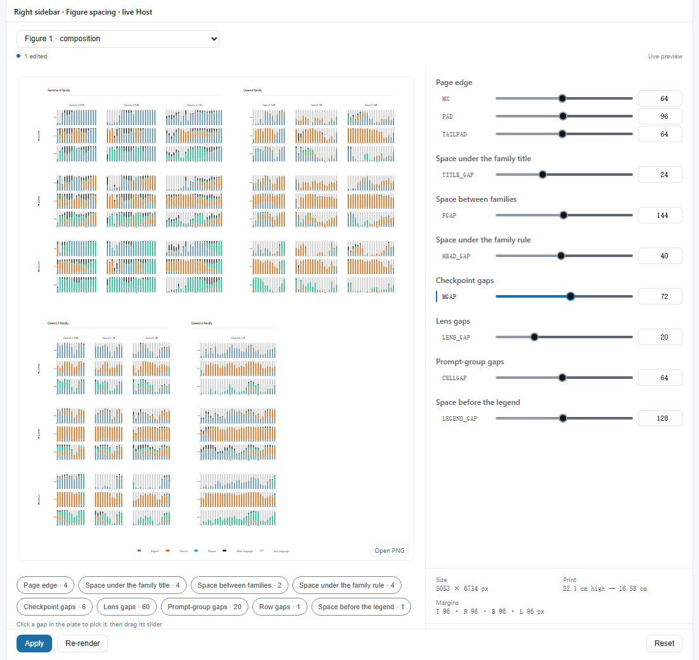

# Figure spacing editor

A Host plugin for the J-Prism figure plates. It reads the spacing tokens from the
figure source, measures the margins actually present in the rendered PNG, patches
the tokens, and re-renders with the same command the manuscript pipeline uses.

## What it provides

- Tools: `fig_spacing_read`, `fig_spacing_apply`, `fig_spacing_audit`.
- A loopback HTTP service (`127.0.0.1`, configured port) used by the sidebar
  editor: `GET /state`, `GET /figure.png`, `GET /audit`, `POST /apply`,
  `POST /render`.

## Tokens

Figure 1 (`make_family_grids.py`): `PH`, `LENS_GAP`, `CELLGAP`, `MGAP`,
`TITLE_GAP`, `HEAD_GAP`, `LABH`, `LABEL_GAP`, `ROW_GAP`, `ROW_FAM_GAP`,
`TICKROW`, `RULE_Y`, `MX`, `PAD`, `LEGEND_GAP`, `TAILPAD`, `FGAP`, `PLAB`,
`LENSW`.

Figure 2 (`make_readme_figs_svg.py`, inside `draw_overlap`): the same set minus
`PAD`; its saved-image padding is a literal `pad=96` and the audit reports the
real margin.

## Limits

The plugin edits numbers only; it never rewrites structure. The service binds to
loopback and holds no credentials. Rendering runs the project's own Python
environment, so a change costs the same time as running the figure script.

## Using the sidebar editor

1. Reload the DSH page once after installing the bundle, so the Client half is
   served.
2. Open the right Sidebar and click the add control; choose **Figure spacing
   editor**. Nothing opens by itself, so other conversations keep their own
   right Sidebar untouched. On load the plugin also closes this tab in any
   conversation that is not on screen, which clears leftovers from older
   versions that opened automatically.
3. Pick Figure 1 or Figure 2. The tab reads /state and /audit from the Host,
   shows the current render, the measured margins, and the tokens grouped into
   page/title and panel/row controls.
4. Move a slider or type a value, then **Apply and render**. The Host patches the
   source file, runs the figure script, and returns the new state; the preview
   reloads with the new render. **Reset** returns the controls to the last
   applied state.

The preview above is the real Client component rendered by headless Edge against
the live Host service (React UMD, mocked session props). The in-app tab is the
same component inside the right Sidebar.

## Live preview

The matplotlib render costs about 13 s, so the tab does not wait for it while
you drag. The Host keeps a fast SVG renderer (`tools/fig-test/quick_svg.py`) that
lays out the plate with the same geometry rules and emits an SVG plus the gap
zones in about 0.2 s. Every draft change calls `POST /quick` after a 120 ms
debounce and swaps the SVG, so the plate moves roughly 0.3 s after a slider stops.
**Apply** still runs the real figure script for the authoritative PNG.

## Zone map

The Figure 1 generator writes `fig1_merged_grid_print.png.layout.json` next to
the PNG on every render. Each zone carries `kind`, a readable `label`, the
tokens that name it, and a pixel `box` computed from the same canvas coordinates
the plate was drawn with, so a zone stays on its gap when the spacing changes.

Figure 2 does not export a zone map yet. Selecting it shows the full token list
with no clickable gaps.

## Layout

The tab adapts to the width it is given. Wide panes (860 px and up) put the
plate on the left at up to 800 px tall and a 420 px control column on the right,
with the measurements pinned to the bottom of that column. Narrow panes stack
the plate (40% of the window height) above the controls.

## Hover

Hovering any gap draws a box around every gap of that kind. The border and fill
are inline styles driven by the hover state as well as CSS :hover, and the
overlay is a plain element with z-index: 2, so a stylesheet or user-agent
button rule cannot suppress the box., so the whole spacing
class lights up before you click. The hit area is the gap plus 4 px on each side,
which keeps the narrow checkpoint gaps easy to reach. Hovering a chip below the
plate does the same.

## Accessibility and platform behaviour

- The plate gaps are pointer affordances only: they are removed from the tab
  order and hidden from assistive technology. The chip row above the controls is
  the keyboard path, with `aria-pressed` on each gap type.
- Sliders stay native range inputs. The track, thumb and filled part are styled
  with vendor pseudo-elements, the fill is driven by `--pct`/`--fill` custom
  properties (grey until a token is edited), and `aria-valuetext` carries the
  value and unit.
- Every control has a `:focus-visible` outline, the editor exposes one hidden
  `h1`, `h2` sections and a labelled region, and status changes use
  `role="status"` or `role="alert"`.
- `prefers-color-scheme: dark`, `forced-colors: active` and
  `prefers-reduced-motion: reduce` have explicit rules.

## Fallback without the fast renderer

When /quick fails, the plate falls back to the sidecar PNG. That branch used to
render the image without any gap overlays, so hover and click did nothing. It now
draws the image at the same fitted size as the SVG preview (scaled into
columnW x previewH, lex: 0 0 auto so the flex parent cannot collapse it) and
puts the sidecar zones over it in image-space percentages. A failed /quick
call is silent: the image and overlays stay, and the status reads
102 places instead of Live preview.
